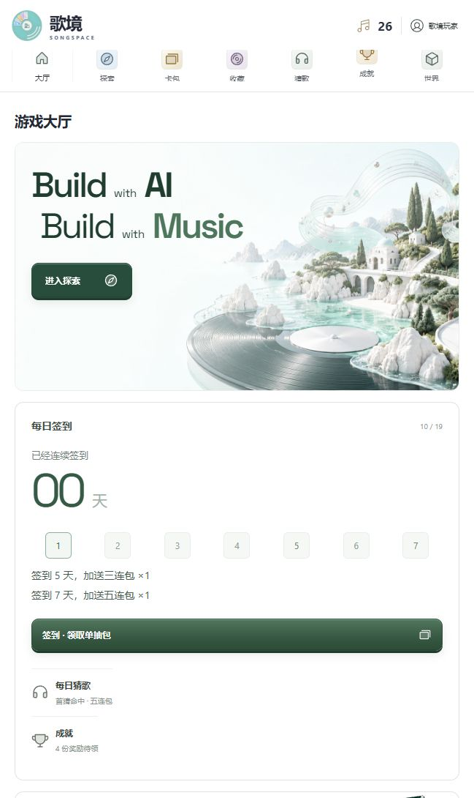
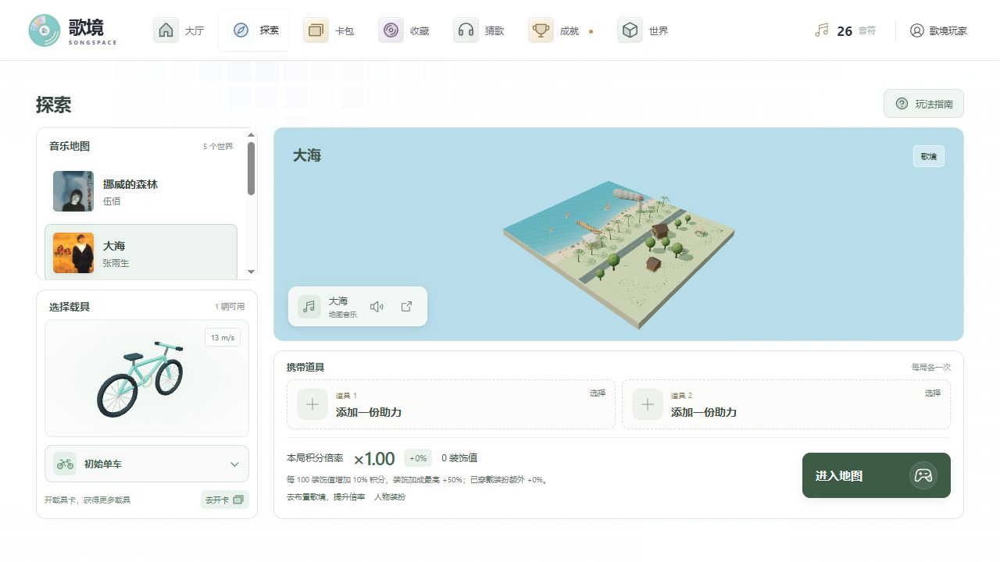
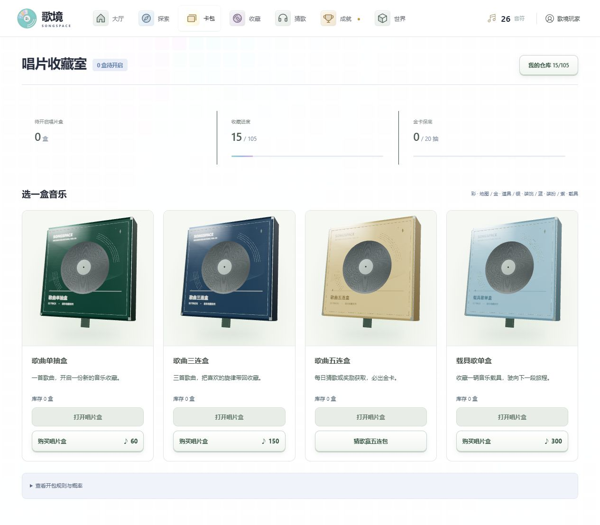
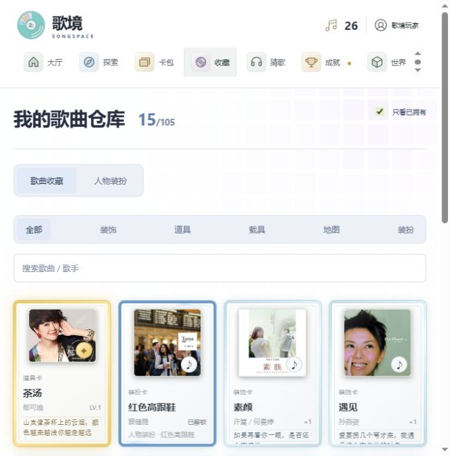
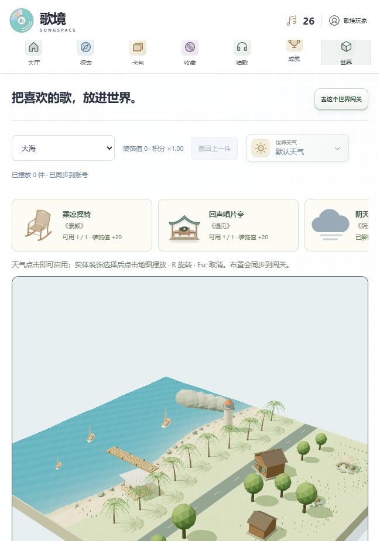
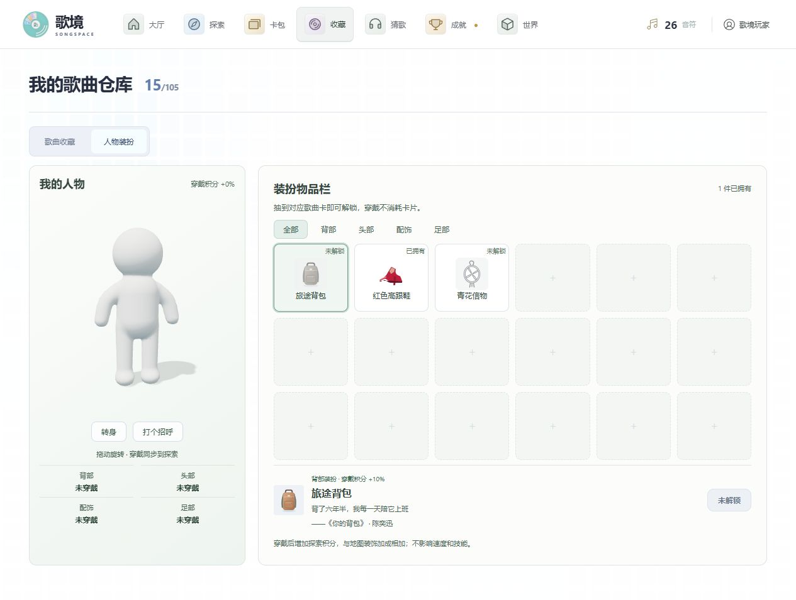

<div align="center">


# 歌境 · SongSpace

### 收藏音乐，走进它的世界。

从一张唱片出发，探索歌曲里的风景，收藏旅途中的惊喜，搭建属于你的音乐世界。

**Build with AI. Build with Music.**

[探索音乐世界](#音乐有了可以走进去的风景) · [唱片收藏室](#每次开启都是新的收藏) · [快速开始](#快速开始) · [开发文档](#技术与文档)

**105 首歌曲** · **5 个音乐世界** · **5 类歌曲卡** · **跨设备存档**

</div>



## 让喜欢的歌，成为你的世界

歌境是一款融合 **3D 音乐探索、歌曲收藏与微缩世界布置** 的 Web 游戏。在《大海》的海岸公路骑行，在《江南》的青石板街穿行，也可以收集彩卡，解锁《富士山下》与《光年之外》的新风景。

探索获得音符，开启唱片盒，再让收藏的歌曲化作载具、道具、装扮与景物。音乐不只留在歌单里，也成为下一段旅途的一部分。

> 当前为持续研发中的可游玩 Demo。本文截图于 **2026-10-19** 从本地运行的网页实际拍摄；展示进度与库存仅代表拍摄时的账号状态。

## 音乐有了可以走进去的风景

出发前，先从实时三维微缩场景认识一张地图。选择载具、搭配两个道具槽，确认本局积分倍率，再随入场镜头走进歌曲的世界。



| 音乐世界 | 旅途中的风景 | 开放方式 |
| --- | --- | --- |
| 《挪威的森林》· 伍佰 | 林间步道、松林与雾化远景 | 初始开放 |
| 《大海》· 张雨生 | 海岸公路、动态海浪、棕榈树与灯塔 | 初始开放 |
| 《江南》· 林俊杰 | 青石板街、石桥、白墙黛瓦与乌篷船 | 初始开放 |
| 《富士山下》· 陈奕迅 | 富士山、湖畔与樱花景致 | 获得同名彩卡解锁 |
| 《光年之外》· G.E.M.邓紫棋 | 月面地形、陨石坑、基地与星球车景物 | 获得同名彩卡解锁 |

探索自动向前，通过换道、跳跃和减速收集金币、躲避障碍；每 500 米进入下一关，速度与难度逐步提高。支持追随、侧后方和第一人称视角，地图音乐随探索开始、暂停与结束联动，并提供音乐开关及 QQ 音乐入口。

## 每次开启，都是新的收藏

唱片收藏室以 **抽屉式唱片盒** 承载开包体验：拉开收藏盒、揭晓卡背、逐张翻卡，再将整盒收获收入仓库。支持跳过动画与减少动态效果偏好；奖励在开启时入库，关闭揭晓界面不会重复发放。



| 歌曲卡 | 收藏如何参与游玩 |
| --- | --- |
| 装饰卡 · 银 | 将山茶花、摇椅、篝火、钢琴等歌曲意象摆入世界；部分歌曲解锁天气或青花配饰 |
| 道具卡 · 金 | 提供护盾、吸币、复活、回血、回溯等九类能力；重复卡可提升等级 |
| 载具卡 · 紫 | 解锁《单车》的后架单车、《一路向北》的 AE86、《鲜花》的烂摩托 |
| 地图卡 · 彩 | 收藏歌曲地图；《富士山下》《光年之外》解锁对应世界 |
| 装扮卡 · 蓝 | 将《你的背包》《红色高跟鞋》穿在人物身上，带入探索 |

仓库支持分类、歌曲与歌手搜索、只看已拥有及卡牌详情。封面、歌词短摘句与玩法身份共同组成每张歌曲卡的收藏信息。



当前曲库由 **2026-10-08 QQ 音乐热歌榜 100 首快照及补充歌曲**组成，共 105 首，并非实时排行榜。

## 把旋律留下，也把它带在身上

歌曲意象可以手动摆入微缩世界，各地图分别保存布局。装饰库存跨地图共用，摆放消耗可用库存，撤回后返还；已布置景物也会出现在探索前段。

《黄昏》《雨爱》《认真的雪》《阴天》分别解锁夕阳、雨天、雪天与阴天，让微缩世界与探索场景共享天气。人物装扮支持三维预览、旋转与穿戴：背包和高跟鞋各增加 10% 探索积分，青花信物提供腰侧配饰。

| 微缩世界 | 人物装扮 |
| :---: | :---: |
|  |  |

## 每次回来，都有新的收获

- **新手补给**：500 音符、3 个单抽包、1 个三连包和 1 个载具包，注册后即可开始收藏。
- **每日签到**：每天领取单抽包，连续第 5 天加送三连包，第 7 天加送五连包；每 7 天一轮，断签重新计数。
- **每日猜歌**：看卡通意象猜歌曲，每天 6 次机会；首猜命中获得五连包，第 2–3 次三连包，第 4–6 次单抽包。
- **探索成就**：12 项目标覆盖里程、最高分、收藏、开包、签到与猜歌，达成后领取卡包。
- **进度随行**：保存收藏、装备、布局与最近十次探索记录，使用账号 ID 跨设备恢复。

## 第一次游玩

1. 填写 2–16 字昵称注册，并妥善保存系统分配的账号 ID。
2. 进入卡包页，开启新手唱片盒，到收藏页查看歌曲与能力。
3. 选择地图，装备载具与最多两个道具，开启探索。
4. 收集金币、结算音符，再购买唱片盒，或用歌曲景物布置自己的世界。

| 操作 | 按键 / 入口 |
| --- | --- |
| 左右换道 | `A` / `D` 或左右方向键 |
| 跳跃 / 减速 | `空格` / `S` |
| 使用道具 | `1` / `2` 或点击道具栏，每个槽每局一次 |
| 暂停 / 继续 | `Esc` 或界面按钮 |
| 切换视角 | 场景内的视角按钮 |
| 窄屏操作 | 屏幕上的换道和跳跃按钮 |

<details>
<summary>查看积分、唱片盒与保底规则</summary>

基础得分为每米 1 分、每枚金币 50 分，结算每 40 分兑换 1 音符。世界装饰每 100 值增加 10% 积分，装饰加成最高 50%；穿戴加成额外计入，倍率在开局锁定。

单抽盒 60 音符，三连盒 150 音符，载具歌单盒 300 音符。五连盒通过奖励获得，至少包含一张道具金卡。普通歌曲包连续抽取时，获得金卡或彩卡会重置保底计数；计数达到 20 时保证道具金卡。

</details>

## 快速开始

完整登录与存档体验需要同时运行前端、后端与 PostgreSQL。

**环境**：Python 3.12+、PostgreSQL，以及 Node.js `^22.18.0` 或 `>=24.12.0`。以下命令适用于 Windows PowerShell。

### 启动后端

在项目根目录执行；已有虚拟环境可直接使用。

```powershell
python -m venv .venv
.venv\Scripts\python.exe -m pip install -e ".[dev]"
if (!(Test-Path .env)) { Copy-Item .env.example .env }
# 创建 PostgreSQL 数据库，并在 .env 中填写实际 DATABASE_URL
.venv\Scripts\python.exe -m alembic upgrade head
.venv\Scripts\python.exe -m uvicorn app.main:app --host 127.0.0.1 --port 8000
```

### 启动前端

另开一个终端：

```powershell
cd songspace-web
npm ci
npm run dev -- --host 127.0.0.1 --port 5173
```

打开 [歌境登录页](http://127.0.0.1:5173/login)。Vite 会将 `/api` 转发到本机 8000 端口；后端接口文档位于 [Swagger UI](http://127.0.0.1:8000/docs)。

## 技术与文档

| 层级 | 技术与职责 |
| --- | --- |
| 交互界面 | Vue 3、TypeScript、Vite，承载大厅、收藏、活动与账号界面 |
| 3D 与动效 | Three.js 场景、载具和人物；GSAP 开包、翻卡与入场动效 |
| 服务接口 | FastAPI、Pydantic，提供账号、会话、健康检查与存档接口 |
| 数据存储 | PostgreSQL、SQLAlchemy、Alembic，保存账号进度并管理数据迁移 |
| 存档机制 | 浏览器本机缓存与云端同步，修订号防止旧存档覆盖较新进度 |

- [产品总结与功能介绍](docs/product/overview.md)：适合产品交流、演示和功能概览。
- [前端开发指南](songspace-web/README.md)：开发命令、玩法模块与专项验证。
- [后端开发指南](docs/development/backend.md)：环境配置、数据模型、API 与迁移验证。
- [宝塔 Demo 部署](docs/deploy/baota-demo.md) · [部署包说明](deploy/README.md)：生产代理、静态资源与发布包使用。
- [内容来源与策划记录](docs/plans/2026-10-08-qqmusic-hot-100.md)：榜单快照及歌曲数据说明。

## 当前版本说明

当前已形成账号、探索、结算、收藏、装备、布置与云端存档的完整体验循环。购买、抽卡和探索结算由客户端计算，服务端负责账号与存档；共享排行榜、反作弊与 AI 歌曲分析尚未接入。太空场景中的星球车为环境景物，尚不可装备驾驶。

项目持续完善歌曲对应的模型与展示素材，部分歌曲仍使用通用意象。研发期间可能调整卡片效果、资源结构和存档格式。低性能设备与真实移动设备性能仍待验证。
