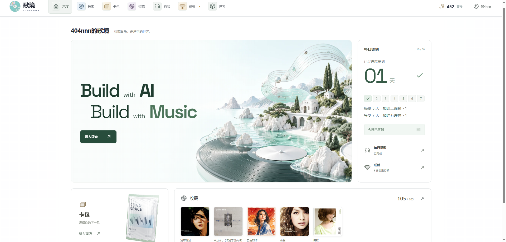
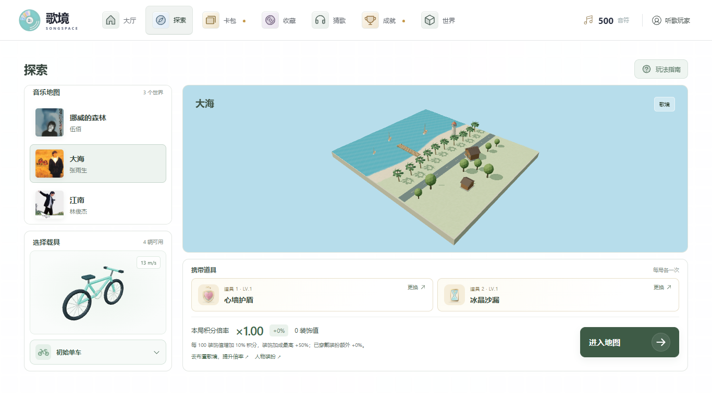
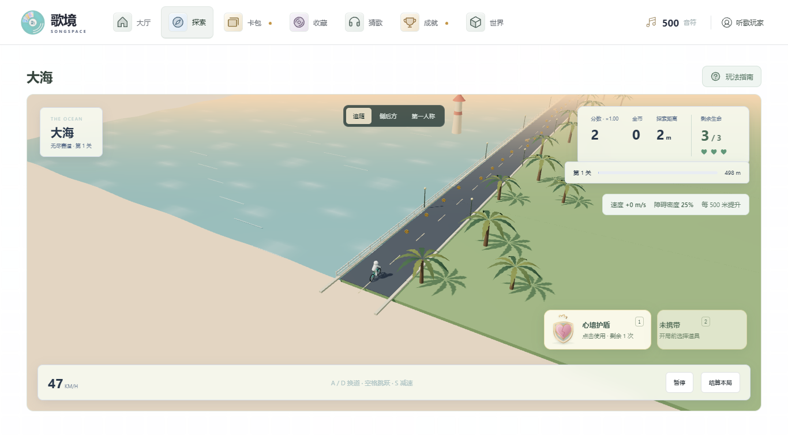
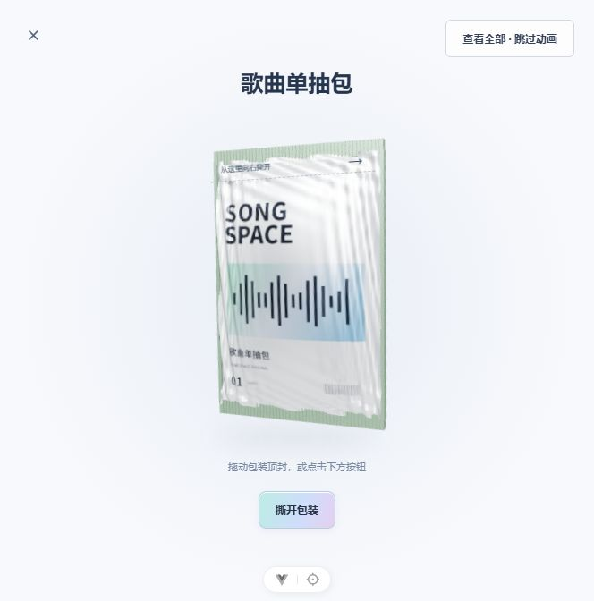
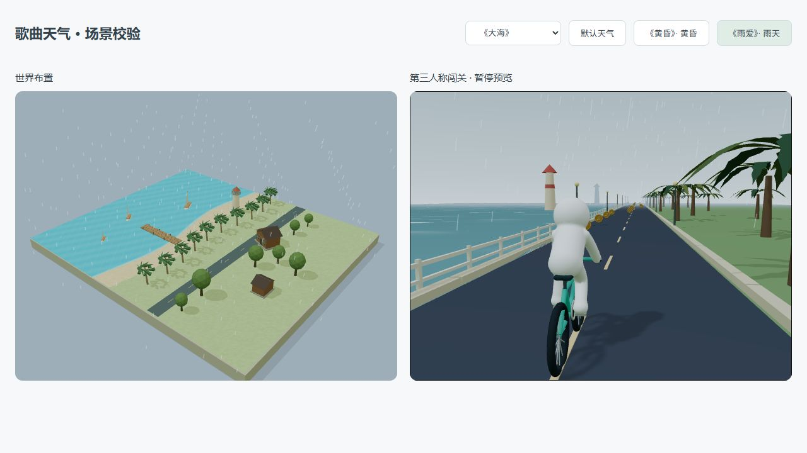

<div align="center">


# 歌境 · SongSpace

### 收藏音乐，走进它的世界。

将一首歌变成一次旅程、一件收藏，和属于你的微缩世界。

**Build with AI. Build with Music.**

[产品介绍](docs/product/overview.md) · [快速开始](#快速开始) · [前端开发](songspace-web/README.md) · [后端开发](docs/development/backend.md) · [部署指南](docs/deploy/baota-demo.md)

**105 首歌曲** · **3 个音乐世界** · **5 类歌曲卡** · **跨设备存档**

</div>



## 让喜欢的歌，成为可以探索的地方

歌境是一款融合 **3D 音乐探索、歌曲卡牌收藏与微缩世界布置** 的 Web 游戏。你可以沿着《大海》的海岸公路前进，在《江南》的青石板街穿行，或走进《挪威的森林》的林间步道。

旅途中收集金币、躲避障碍，获得音符；拆开卡包，把歌曲收藏为道具、载具、装扮与景物，再带着它们开启下一段旅程。

> 项目正在研发中，玩法、卡包物品与相关素材持续更新。下方展示当前界面与场景预览，内容会随开发进展调整。

## 一首歌，多种玩法

| 体验 | 你可以做什么 |
| --- | --- |
| 音乐探索 | 选择歌曲地图，以追随、侧后方或第一人称视角探索；收集金币、换道避障、跳跃闯关 |
| 拆包收藏 | 购买歌曲包或载具包，拖动撕封、逐张翻卡，收集真实歌曲封面与短摘句 |
| 歌曲道具 | 装备两个道具槽，使用护盾、吸币、回血、复活、回溯等能力；重复卡提升道具等级 |
| 歌曲载具 | 解锁《单车》的后架单车、《一路向北》的 AE86、《鲜花》的烂摩托，改变外观与巡航速度 |
| 微缩世界 | 手动摆放歌曲意象装饰，撤回返还库存；用《黄昏》《雨爱》切换天气 |
| 人物装扮 | 收藏《你的背包》，解锁旅途背包；预览、穿戴并带入探索 |
| 每日活动 | 签到领取卡包，看卡通意象猜歌，完成探索、收藏与日常成就 |
| 长期进度 | 保存收藏、装备、世界布置与最近十次探索记录，使用账号 ID 跨设备恢复 |

### 01 · 从一张微缩地图，走进一首歌

三张初始地图直接开放。出发前选择载具与道具，查看本局积分倍率；入场镜头从微缩场景过渡到探索视角。



| 歌曲世界 | 场景特色 |
| --- | --- |
| 《挪威的森林》· 伍佰 | 林间步道、树木与雾化远景 |
| 《大海》· 张雨生 | 海岸公路、动态海浪、棕榈树与灯塔 |
| 《江南》· 林俊杰 | 青石板街、石桥、白墙黛瓦、垂柳与乌篷船 |

探索自动向前，每 500 米进入下一关，逐渐增加速度和障碍难度。地图音乐随探索开始、暂停与结束联动，支持关闭音乐及跳转 QQ 音乐。



### 02 · 把拆包的惊喜，变成自己的音乐收藏

立体箔膜包装、拖动撕封、卡背揭晓、透视翻转与整包汇总，构成完整的开包过程。支持跳过动画及减少动态效果偏好；卡牌在撕包时入库，关闭或刷新不会丢失已获得的奖励。



歌曲仓库支持分类、歌曲与歌手搜索、只看已拥有、卡牌详情和 QQ 音乐跳转。当前曲库由 **2026-10-08 QQ 音乐热歌榜 100 首快照及补充歌曲**组成，共 105 首，并非实时排行榜。


五类卡片分别对应装饰、道具、载具、地图和装扮。金色边框表示道具卡，彩色边框表示地图卡；稀有度与玩法身份相互关联。

### 03 · 把歌曲留下，也把它带在身上

花园、雪庭、月灯、观景台与唱片亭可以布置在自己的微缩世界里。装饰库存跨地图共用，摆放消耗可用库存，撤回后返还；已布置景物还会出现在探索前段。

《黄昏》解锁夕阳，《雨爱》解锁雨天，天气同时作用于微缩世界和探索场景。《你的背包》提供可穿戴的旅途背包，穿戴不消耗歌曲卡，当前额外增加 10% 探索积分。



### 04 · 每次回来，都有一点新的收获

- **新手补给**：500 音符、3 个单抽包、1 个三连包和 1 个载具包。
- **每日签到**：每天 1 个单抽包；连续第 5 天加送三连包，第 7 天加送五连包，每 7 天一轮，断签重新计数。
- **每日猜歌**：每天 6 次机会，首猜命中获得五连包，第 2–3 次获得三连包，第 4–6 次获得单抽包。
- **成就奖励**：12 项成就覆盖探索里程、最高分、收藏数量、开包、签到与猜歌；达到目标后领取卡包。

## 第一次游玩

1. 在登录页填写 2–16 字昵称注册，保存系统分配的账号 ID。
2. 到卡包页拆开新手补给，在收藏页查看获得的歌曲与能力。
3. 选择一张地图，装备载具与最多两个道具，进入探索。
4. 收集金币并躲避障碍，结算获得音符，再购买卡包或布置世界。

| 操作 | 按键 / 入口 |
| --- | --- |
| 左右换道 | `A` / `D` 或左右方向键 |
| 跳跃 | `空格` |
| 减速 | `S` |
| 使用道具 | `1` / `2` 或点击道具栏，每个槽每局一次 |
| 暂停 / 继续 | `Esc` 或界面按钮 |
| 切换视角 | 场景内的追随、侧后方、第一人称按钮 |
| 窄屏操作 | 屏幕上的换道和跳跃按钮 |

基础得分为每米 1 分、每枚金币 50 分，结算每 40 分兑换 1 音符。世界装饰每 100 值增加 10% 积分，装饰加成最高 50%；穿戴加成额外计入，倍率在开局锁定。

单抽包售价 60 音符，三连包 150 音符，载具包 300 音符。五连包仅通过奖励获得，至少包含一张金卡或彩卡；普通歌曲包连续抽取时，获得金卡或彩卡会重置保底计数，计数达到 20 时保证道具金卡。

## 快速开始

完整登录与存档体验需要同时运行前端、后端与 PostgreSQL。

**环境**：Python 3.12+、PostgreSQL，以及 Node.js `^22.18.0` 或 `>=24.12.0`。以下命令适用于 Windows PowerShell。

### 启动后端

在项目根目录执行；已有虚拟环境可直接使用。

```powershell
python -m venv .venv
.venv\Scripts\python.exe -m pip install -e ".[dev]"
if (!(Test-Path .env)) { Copy-Item .env.example .env }
# 创建 PostgreSQL 数据库，并在 .env 中填写实际 DATABASE_URL
.venv\Scripts\python.exe -m alembic upgrade head
.venv\Scripts\python.exe -m uvicorn app.main:app --host 127.0.0.1 --port 8000
```

### 启动前端

另开一个终端：

```powershell
cd songspace-web
npm ci
npm run dev -- --host 127.0.0.1 --port 5173
```

打开 [歌境登录页](http://127.0.0.1:5173/login)。Vite 会将 `/api` 转发到本机 8000 端口；后端接口文档位于 [Swagger UI](http://127.0.0.1:8000/docs)。

## 技术与文档

| 层级 | 技术与职责 |
| --- | --- |
| 交互界面 | Vue 3、TypeScript、Vite，承载大厅、收藏、活动与账号界面 |
| 3D 与动效 | Three.js 场景、载具和人物；GSAP 开包、翻卡与入场动效 |
| 服务接口 | FastAPI、Pydantic，提供账号、会话、健康检查与存档接口 |
| 数据存储 | PostgreSQL、SQLAlchemy、Alembic，保存账号进度并管理数据迁移 |
| 存档机制 | 浏览器本机缓存与云端同步，修订号防止旧存档覆盖较新进度 |

- [产品总结与功能介绍](docs/product/overview.md)：适合产品交流、演示和功能概览。
- [前端开发指南](songspace-web/README.md)：开发命令、玩法模块与专项验证。
- [后端开发指南](docs/development/backend.md)：环境配置、数据模型、API 与迁移验证。
- [宝塔 Demo 部署](docs/deploy/baota-demo.md) · [部署包说明](deploy/README.md)：生产代理、静态资源与发布包使用。
- [内容来源与策划记录](docs/plans/2026-10-08-qqmusic-hot-100.md)：榜单快照及歌曲数据说明。

## 当前版本说明

歌境目前正在研发中，玩法、卡包物品与相关素材持续更新。当前先挑选了几张歌曲卡制作对应的模型、场景与展示素材，后续将逐步丰富更多卡片内容。

研发过程中可能会有破坏性修改，卡片效果、资源结构与存档格式等内容可能随版本调整。
